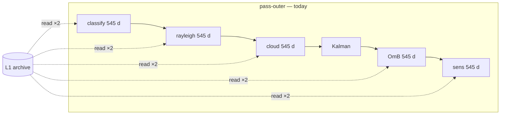
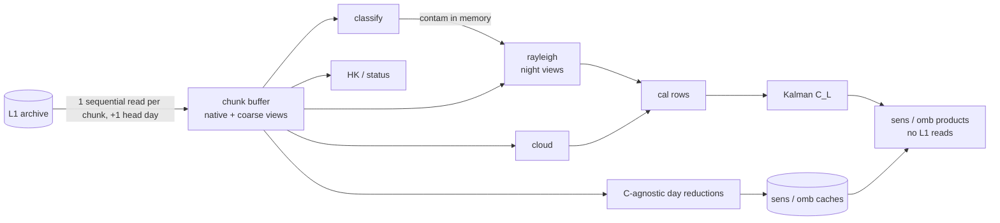

# 11 — Efficient batch reprocessing: chunk-outer read-once design

**Status:** proposal (2026-07-13) · **Scope:** `scripts/run_network_calibration.py` batch path ·
**Goal:** reprocess ~425 streams × 1.5 years reading the L1 archive **once**, on any of the three
hosts (home Windows PC, zueub434, CSCS balfrin), without giving up the measured advantage of
**multi-day batched reads**.

## 1. Problem — measured baseline

The 2026-07-13 home reprocess (24 workers, L1 on a SATA QLC disk) stalled: disk pinned at 100 %
serving ~55 MB/s of random reads, CPU ~7 %, and after 1.5 h only **1 of 48 started streams had a
`_cal.csv`** (47 had classification output only). The identical code ran perfectly as an isolated
CSCS task (Payerne A, June, all products: 5 min 51 s, correct June 20–21 rejection). The failure is
not the science code — it is **I/O amplification** in the batch driver.

Measured anchors used below:

| Anchor | Value |
|---|---|
| Home, 1 stream, 16 d, Rayleigh+plots | 20 s (~1.25 s/day incl. reads) |
| Home, 1 stream, 545 d, Rayleigh-only | 684 s |
| CSCS postproc, 1 stream, 30 d, ALL products | 5 min 51 s (~12 s/day, 4 EPYC cores) |
| CSCS 2026-06 array, per-stream mean | cal 2013 s, sens 1630 s (max 133 / 182 min) |
| Home D: (Samsung 870 QVO SATA) | ~55 MB/s effective under 24-worker random load; ~530 MB/s sequential cap |
| L1 archive 2025-01 → 2026-07, ~425 streams | ≈ 1.2–1.5 TB (sample-based estimate) |

## 2. Root cause — the batch driver multiplies reads ×10

Two multipliers stack in `_process_stream`:

1. **Night pairing ×2.** `build_file_paths` (data_loader.py:85) returns *previous + current day*
   for every night, so within one pass each daily L1 file is read twice (as day D of night D and as
   day D−1 of night D+1). The shared reader's cache is **3 days** (run_network_calibration.py:282)
   — sized for the daily cron, useless across a 545-day sweep.
2. **Pass-outer ×5.** The batch path runs each product over the whole window sequentially —
   `_do_classification(start,end)` → `_do_rayleigh(start,end)` → `_do_cloud(start,end)` →
   `_do_omb(start,end)` → `_do_sens(start,end)` — so by the time pass N+1 revisits day 1, the cache
   was evicted ~544 days ago. Every pass re-reads the whole period.

Net: **~10× the archive bytes per stream** (5 full-content passes × 2 reads/file), plus a
monitoring pass re-opening every file for 1-D housekeeping vars. On Lustre (CSCS) this is absorbed;
on a QLC SATA disk (home) or a slow NAS (zueub434 backfills) it is the bottleneck — ~13 TB of
reads against a ~1.3 TB archive.

Read-once as deployed today is correct **for the daily cron** (1 day: every pass hits the same
cached night) — the design below generalises it to arbitrary windows without touching the cron path.

## 3. Design — stream × chunk, read once, calibrate late

Keep the parallelism unit = **stream** (works identically as a Windows pool worker, a zueub434
`--workers N` pool, and a CSCS array task). Inside a stream, invert the loop **per chunk**, not per
day — this preserves the multi-day batched read that was measured to be much faster than day-by-day
reads (fewer opens, sequential layout, one decode pass):

```
for chunk in split(window, ALC_CHUNK_DAYS):            # default 31 d; 1 d ≡ current daily behaviour
    files = L1[chunk.start − 1 day .. chunk.end]       # +1 head day for the first night
    idd   = load_instrument_day(files, ...)            # ONE batched read (existing API takes a file list)
    for D in chunk.days:
        night = idd.slice_night(D)                     # NEW: [D−1, D] time-view of the chunk (native)
        day   = idd.slice_to_date(D)                   # existing, memoised view (coarse grid)
        classification(day, CAMS_T)                    #  -> .nc (+ contam profile kept IN MEMORY)
        rayleigh(night, contam_profile)                #  same inputs as today -> same results
        cloud(day)
        hk/status from the same open                    #  no re-open
        reduce day for sens / omb                       #  C-agnostic reductions -> caches (M2/M3)
    del idd                                            # bound memory to one chunk
kalman  <- cal rows                                     # no I/O
sens/omb products <- caches × Kalman C_L                # no L1 reads
```

The pieces mostly exist: `load_instrument_day` already accepts a list of files
(instrument_day.py:277), `slice_to_date` is already a memoised view (instrument_day.py:114),
`to_omb_dict` already feeds OmB/sens from the shared read. The new code is the chunk loop, a
`slice_night(D)` view, and the cache plumbing below.

### The Kalman dependency (why OmB/sens re-read today)

OmB and sensitivity consume the **full-period Kalman C_L**, which only exists after all nights are
calibrated — that is why they run as separate re-reading passes today. Two-step fix:

- **M2 (no science change):** during the single sweep, spill each day's **coarse working grid** to a
  per-stream temp file (~15 % of native bytes); after Kalman, feed OmB/sens from the spill and
  delete it. Total I/O ≈ 1.0× native read + ~0.2× write + ~0.2× read ≈ **1.4×**.
- **M3 (better, optional):** make the `_omb_cache` / `_sens_cache` reductions **C-agnostic** — store
  signal-level (rcs) reductions during the sweep and divide by the day's C_L at *aggregation* time
  (σ-noise is already documented C_L-invariant; O−B obs profiles scale linearly by 1/C). Single
  sweep, ≈ **1.03×** (head-day overlap only). Schema bump ⇒ rebuild caches once.

## 4. Flow — before / after





## 5. Milestones

| # | What | Touchpoints | Effort |
|---|---|---|---|
| M0 | Instrument per-pass `read_bytes` (psutil) on 1 stream; confirm the ×10 and re-measure after each milestone | new `validation/_io_probe.py` | ~½ day |
| M1 | Chunk loop in `_process_stream` + `InstrumentDayData.slice_night()`; classify/rayleigh/cloud/HK consume views; contam profile handed to Rayleigh in memory (keep writing the .nc for the dashboard). Env `ALC_CHUNK_DAYS`, **default 1 = today's behaviour** → zero-risk deploy, cron untouched | run_network_calibration.py, instrument_day.py | 1–2 d |
| M2 | Working-grid spill for OmB/sens (write during sweep, consume after Kalman, delete) | run_network_calibration.py, incremental.py | ~1 d |
| M3 | C-agnostic OmB/sens caches (apply C_L at aggregation); cache schema bump + one-off rebuild | omb/omb.py, sensitivity/, incremental.py | 2–3 d |
| M4 | Golden validation: 0-20000-0-06610 A/B/C + 1 CL51 + 1 Mini-MPL — `_cal.csv`/`_kalman.csv` identical, sens/omb within float tolerance, June 20–21 stay flag −2 | tests/ | ~½ d |

## 6. Per-machine behaviour

| Host | Setup | Expected |
|---|---|---|
| **Home PC** (i9-14900KF, 128 GB; L1 on QLC SATA; CAMS moved to NVMe) | 10–16 workers, `ALC_CHUNK_DAYS=31` (14 for CL61) | reads become ~sequential; disk ≈ 1.5–2 h total, run CPU-bound **~10–18 h overnight** (vs infeasible today) |
| **zueub434** (slow NAS, no sudo) | cron unchanged (chunk=1 ≡ today); backfills with `ALC_CHUNK_DAYS=31` | reprocess/backfill ≈ **×5–7 faster**; daily cron zero-risk |
| **CSCS balfrin** (postproc array) | sbatch unchanged + env | **−30–40 % core-hours** (decode-once); wall 5–8 h → ~3–5 h at same throttle (big CL61 tail streams shrink most) |

Memory bound per worker/task = one chunk: CL61 native 31 d ≈ 6.4 GB (→ use 14 d), CHM15k ≈ 0.7 GB,
CL31/CL51 smaller. Fits CSCS 32 GB tasks and 10–16 home workers in 128 GB. CAMS: memoise per
(stream, month) instead of per day — minor but free.

## 7. Estimated gains (per stream, S = its share of the archive)

| Stage | L1 bytes read | vs today |
|---|---|---|
| Today (pass-outer) | ≈ 10 S (+ HK opens) | — |
| M1 (chunk for classify/rayleigh/cloud/HK; OmB+sens legacy) | ≈ 1 S + 4 S = 5 S | ×2 |
| M2 (+ working-grid spill) | ≈ 1.4 S | **×7** |
| M3 (C-agnostic caches) | ≈ 1.03 S | **×10** |

Compute also drops (the netCDF decode/coarsen that today happens 5× happens once) — the −30–40 %
core-hour estimate on CSCS; M0 firms these numbers up.

## 8. Risks / notes

- **Chunk-boundary night**: +1 head day per chunk (~3 % extra reads) — the first night of a chunk
  needs the previous day's evening.
- **Missing days**: the chunk buffer simply lacks those times; per-day presence checks stay as today.
- **CL61 memory**: bound with a per-type chunk cap rather than a global one.
- **Results must be bit-identical**: night views must reproduce exactly the `[D−1, D]` union the
  per-night reader produces today (M4 asserts this on golden streams).
- **Daily cron**: `ALC_CHUNK_DAYS=1` is the default and is byte-for-byte today's read-once path —
  the batch speedup cannot regress operations.
